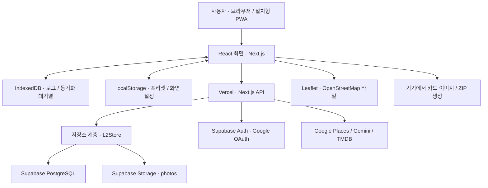
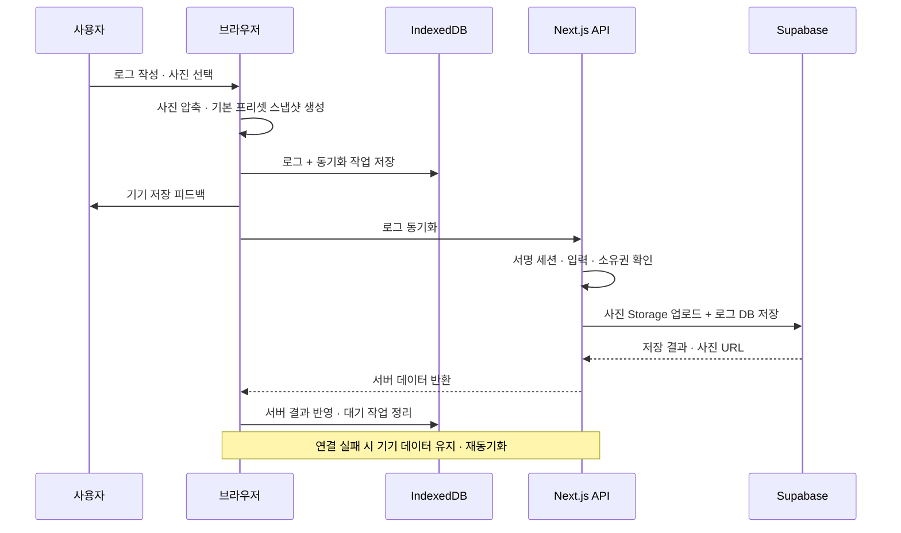

# L2 프로젝트 구조 요약

기준: 2026-10-18, 로컬 코드 기준(카드 PNG 내보내기 후속 변경 포함). 실제 애플리케이션 루트는 `alpha/`입니다. 이 문서는 코드 구조 요약이며 운영 서비스 상태를 새로 검사한 결과는 아닙니다.

## 1. 전체 구조

**Next.js 한 프로젝트 안에 프론트엔드와 백엔드 API가 함께 있는 풀스택 PWA입니다.** Vercel이 웹 화면과 API를 배포하고, Supabase가 DB·사진 저장소·구글 인증을 담당합니다. 별도의 Express/NestJS 서버는 없습니다.



## 2. 프론트엔드

| 구분 | 현재 구성 |
|---|---|
| 기반 기술 | Next.js 16.4.2 App Router, React 19.2.4, TypeScript |
| 스타일 | Tailwind CSS 4 + 컴포넌트별 일반 CSS / CSS Modules |
| 글꼴·아이콘 | 로컬 세방고딕 중심, Pretendard 전환 지원, Lucide 아이콘 |
| 화면 구성 | `src/app/page.tsx`가 로그·로그북·카드 상세·스튜디오 상태를 관리. 설정은 오버레이 |
| 로그 작성 | `QuickLogComposer`: 제목·내용·사진 1장·장소·평점·분류 |
| 로그북 | `ArchiveBrowser`: 검색·분류·정렬·리스트/카드/지도·그룹 관리 |
| 카드 상세 | `CardWorkspace`: 프리셋 선택, 해당 로그의 디자인·색상·세부사항·사진 조정, 저장·공유 |
| 스튜디오 | `StudioPanel`, `PresetLibrary`: 재사용할 프리셋 제작·정렬·카테고리별 기본값 설정 |
| 카드 렌더링 | `CardStage`, `AdditionalCardLayouts`, `CardFrame`: 공통 데이터로 다양한 카드 디자인 렌더링 |
| 상태 관리 | React state/hooks + 전용 repository 클래스. Redux/Zustand 사용 안 함 |
| 기기 저장 | 로그·동기화 대기열은 IndexedDB, 프리셋·화면 설정 등은 localStorage |
| PWA | manifest + Service Worker로 설치 안내·앱 리소스 캐시·오프라인 진입 지원 |

로그 변경은 `useArchiveRepository → LocalArchiveRepository`를 거칩니다. 기기에 먼저 기록하고 서버 동기화를 시도하며, 실패한 작업은 대기열에 남겨 재시도합니다. 프리셋도 `usePresetPreferences`를 통해 기기 저장과 서버 동기화를 관리합니다. **기기 저장 완료와 서버 동기화 완료는 구분됩니다.**

카드에는 적용 당시의 디자인 스냅샷(`cardAppearance`)이 저장됩니다. 따라서 스튜디오 원본 프리셋을 수정해도 기존 로그 카드가 일괄 변경되지 않습니다. 사진 위치·확대·채움 방식도 로그 데이터로 보관합니다.

## 3. 백엔드

Next.js의 `src/app/api/**/route.ts`가 HTTP API를 담당합니다. API는 세션 확인·입력 검증·소유자 확인을 거쳐 저장소 계층이나 외부 API를 호출합니다.

| API | 역할 |
|---|---|
| `/api/session` | 세션 확인, 아이디·비밀번호 등록/로그인, 기기 복원 등 |
| `/api/auth/google`, `/api/auth/google/callback` | Supabase Auth를 통한 구글 OAuth 시작·콜백 처리 |
| `/api/logs` | 로그 조회·생성·수정·삭제, 첨부 사진 업로드 |
| `/api/logs/reset` | 현재 사용자의 전체 로그 삭제 |
| `/api/presets` | 프리셋·팔레트·서명·기본 프리셋 조회/저장 |
| `/api/places/search`, `/api/places/resolve` | 장소 검색·주소/좌표 연결. Google Places 및 대체 검색 경로 |
| `/api/media/search` | TMDB 영화 검색·포스터·소개·평점 조회 |
| `/api/ai/skin` | Gemini 기반 색상 조합 생성 |
| `/api/ai/extract` | 기존 메모 요약 API가 남아 있음. 현재 작성 화면의 AI 요약 버튼은 제거됨 |

저장소 접근은 `src/lib/store/`의 `L2Store` 인터페이스로 분리됩니다. 운영은 `supabaseStore`, 외부 연결 없는 개발·테스트는 `fileStore`를 사용합니다. Vercel에서 Supabase 설정 자체가 없으면 서버 저장 오류를 반환하도록 되어 있습니다. 일부 스키마 누락 처리에는 파일 저장 대체 경로도 남아 있으므로 운영용 영구 저장소는 Supabase를 기준으로 봐야 합니다.

## 4. 데이터와 인증

| 저장 위치 | 주요 데이터 |
|---|---|
| `l2_profiles` | 사용자/기기 소유자 ID, 복원 코드, 서명, 프리셋, 팔레트, 기본 프리셋 |
| `l2_archives` | 소유자 ID + 로그 JSONB. 내용·분류·좌표·그룹·카드 디자인·사진 조정값 포함 |
| `l2_ai_usage` | 소유자·종류·날짜별 사용 횟수. 현재 자체 로그인 해시와 OAuth 계정 식별용 레코드도 함께 사용 |
| Storage `photos` | 사용자가 업로드한 압축 사진. DB에는 해당 사진 URL 저장 |

- **비회원:** 기기 세션으로 소유자를 식별합니다. 이후 로그인하면 비회원 로그를 계정으로 이전하는 경로가 있습니다.
- **구글 로그인:** Supabase Auth + PKCE를 사용하고 서버가 사용자 신원을 검증합니다.
- **아이디·비밀번호:** Supabase Auth의 비밀번호 로그인이 아닌 자체 구현입니다. 비밀번호는 scrypt 해시로 보관합니다.
- **앱 세션:** 서버가 서명한 HttpOnly 쿠키를 사용합니다. 운영에서는 Secure·SameSite=Lax를 설정합니다.
- **DB 접근:** 브라우저가 사용자 테이블을 직접 수정하는 방식이 아니라, Next.js 서버가 서버 전용 키로 접근하고 소유자를 확인합니다. SQL에는 RLS 및 익명/일반 인증 역할의 직접 접근 차단 설정이 있습니다.
- **공개 범위:** `/share/[id]`도 현재 소유자 확인을 거칩니다. 사진 버킷은 public URL 방식이므로, 로그 DB의 비공개성과 사진 URL의 공개 접근 가능성은 별개입니다.

## 5. 이미지·지도·AI·공유

- **사진 업로드:** 브라우저에서 WebP로 변환. 가로 최대 1080px, 세로 최대 2160px, 품질 0.8을 기준으로 크기를 줄여 300KiB 이하로 처리합니다. 이후 API가 Supabase Storage에 업로드합니다.
- **영화 포스터:** TMDB 외부 이미지 URL을 사용합니다. 별도 사진 복제 업로드를 기본으로 하지 않습니다.
- **지도:** Google Places는 장소/좌표 검색에 사용하고, 실제 지도 화면은 Leaflet + OpenStreetMap 타일로 표시합니다.
- **AI:** 서버에서 Gemini를 호출합니다. 애플리케이션의 생성 요청 한도는 소유자별 하루 20회이며, 공급자 무료 할당량이나 요청당 모델 재시도 횟수와는 다른 개념입니다.
- **카드 내보내기:** 기기에서 HTML/CSS 카드를 SVG·Canvas로 렌더링하고 사진·폰트를 포함해 투명 PNG로 만듭니다. 최대 가로 1080px, 500KiB 이하입니다.
- **공유:** Web Share API로 카드 파일을 넘기고, 장소가 연결되어 있으면 구글지도 URL을 추가합니다. 원문 로그 내용은 공유 텍스트에 넣지 않습니다. 실제 공유 대상 앱은 기기의 공유 창에서 선택합니다.
- **전체 백업:** 브라우저에서 JSZip으로 CSV·JSON·사진을 묶습니다. 서버에 ZIP 압축 작업을 맡기지 않습니다.

## 6. 핵심 저장 흐름



## 7. 개발자가 먼저 볼 위치

```text
ProjectL3/
└─ alpha/
   ├─ src/app/          화면 진입점 · API · 소유자용 카드 조회 경로
   ├─ src/components/   로그 · 로그북 · 카드 · 스튜디오 · 설정 UI
   ├─ src/hooks/        로그/프리셋 저장 연동 · 초안 · 제스처 · 가이드
   ├─ src/lib/          동기화 · 인증 · 이미지 · 공유 · 외부 API
   │  └─ store/         Supabase / 파일 저장 구현
   ├─ src/data/         초기 프리셋 · 팔레트 · 스튜디오 예시 데이터
   ├─ src/types/        공통 TypeScript 데이터 타입
   ├─ public/           Service Worker · 폰트 · 아이콘 · 이미지 코덱
   ├─ supabase/         DB 스키마 · 접근 제한 SQL
   └─ scripts/          브라우저·API·저장소·공유 회귀 검증 스크립트
```

현재 구조에서 추후 정리할 지점은 두 가지입니다. 첫째, 화면 전환·저장·공유 처리가 모인 `page.tsx`를 기능별로 분리하는 것입니다. 둘째, 임시로 사용량 테이블에 함께 저장한 자체 계정 정보를 인증 전용 구조로 분리하는 것입니다. 새 Supabase 프로젝트로 이전할 때는 소유자 ID·Google Auth UUID·사진 URL·접근 정책도 함께 맞춰야 합니다.
