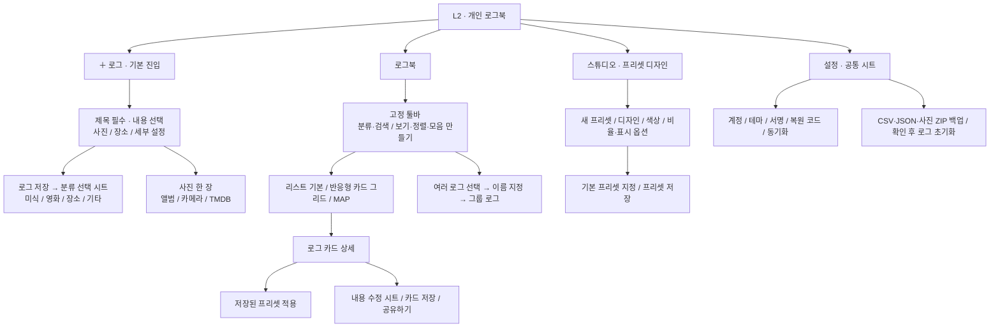
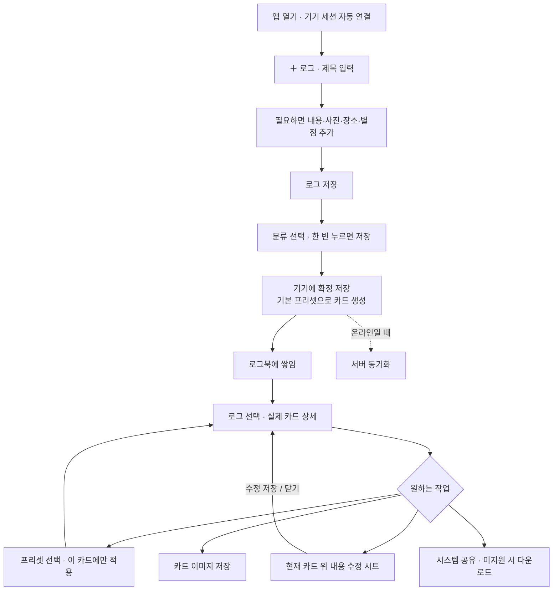
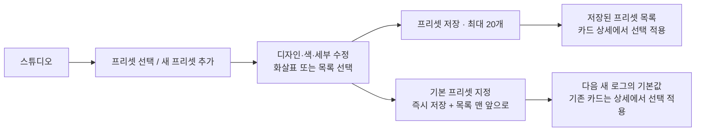
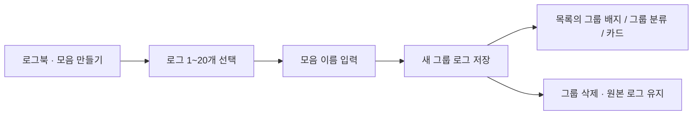

# ProjectL3 · 로그북 IA와 사용자 흐름

2026-10-18 · 운영 앱 `alpha`의 구조입니다. 설치·로그인을 먼저 안내하며, 다른 기기에서는 설정의 아이디·비밀번호 또는 복원 코드로 연결합니다.

## 화면·메뉴 트리

카드는 상위 탭이 아닙니다. 별도 `/share/[id]` 코드는 유지하지만 현재 공유 동작은 이미지 파일을 시스템 공유 시트에 전달합니다.

## 기록 → 보관 → 수정·공유

## 프리셋 제작과 모음

## MAP

`장소 검색 → 실제 위도·경도 저장 → Leaflet + OpenStreetMap 핀 → 핀 선택 → 로그 열기` 흐름입니다. 검색과 분류는 지도와 아래 목록에 함께 적용됩니다. 같은 좌표의 로그는 한 핀에 개수를 표시하고 클릭으로 순환합니다.

좌표가 없는 기존 장소는 임의의 위치에 올리지 않습니다. `위치 연결`을 누르면 소유한 기록의 주소를 Google 장소 검색으로 찾고 좌표를 저장합니다. 결제 연결 후 Google Places의 실제 검색 결과와 좌표 저장, OSM 지도 핀까지 확인했습니다. Google 키는 서버에만 보관하며, OSM 지도 자체에는 키가 필요 없습니다.

## 공간과 데이터의 원칙

- 새 로그는 모바일·태블릿·PC 모두 화면 높이를 채우고 사진·긴 글로 넘칠 때 저장 버튼을 반투명하게 고정합니다. 움직이는 입력 박스에는 제목·사진·본문만 넣고 첨부·저장 버튼은 밖에 둡니다.
- 카드 상세와 스튜디오는 가용 높이에 맞춰 카드를 축소합니다. 키보드·접근성 확대·가로 화면처럼 공간이 부족하면 스크롤로 접근을 보장합니다.
- 그라데이션·문구의 잔물결, 사진 삽입, 좌우 카드 교체, 목록 끝의 탄성 반응을 사용합니다. 설정의 움직임에서 기기 설정 / 켜기 / 끄기를 선택할 수 있습니다. 테스트 버전은 새 브라우저에서도 확인할 수 있도록 켜기가 기본입니다. 명시적인 선택은 유지하며, 기기 설정은 OS의 동작 줄이기를 따릅니다.
- 기록은 카드 스타일을 스냅샷으로 갖습니다. 스튜디오의 저장이 기존 기록 전체를 바꾸지 않습니다.
- 그룹은 원본 ID를 참조합니다. 원본 로그를 삭제하면 해당 항목은 그룹에서 표시되지 않습니다.
- 초안, 영속 outbox, 삭제 실행 취소, 소유 기기 확인과 복원 기능을 유지합니다.
